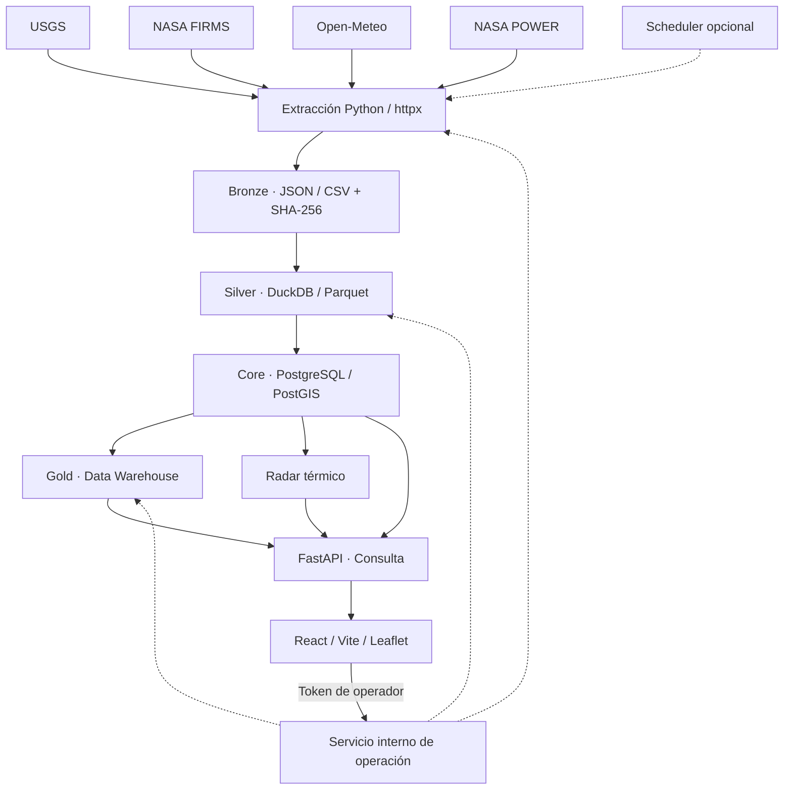

# GeoETL

**Plataforma web de Ingeniería de Datos para el monitoreo y análisis geoespacial de fenómenos ambientales.**

GeoETL integra datos sísmicos, detecciones térmicas satelitales e información meteorológica de distintas fuentes mediante un pipeline ETL reproducible. La plataforma aplica procesos de validación, normalización, deduplicación y almacenamiento geoespacial para facilitar la exploración de datos, el análisis temporal y la supervisión operativa desde una interfaz web.

`Python` · `FastAPI` · `PostgreSQL` · `PostGIS` · `DuckDB` · `Parquet` · `React` · `Leaflet` · `Docker`

**Versión:** 2.0 | **Estado:** prototipo académico funcional, pendiente de validación integral.

## Contenido

- [Funcionalidades](#funcionalidades)
- [Fuentes de datos](#fuentes-de-datos)
- [Radar térmico multifuente](#radar-térmico-multifuente)
- [Arquitectura](#arquitectura)
- [Instalación](#instalación)
- [Operación](#operación)
- [API REST](#api-rest)
- [Pruebas](#pruebas)
- [Estructura del repositorio](#estructura-del-repositorio)
- [Seguridad y limitaciones](#seguridad-y-limitaciones)
- [Documentación](#documentación)

## Funcionalidades

- Extracción de datos desde servicios ambientales externos, con registro de ejecuciones y manejo de errores.
- Conservación de respuestas originales en Bronze con verificación SHA-256 y trazabilidad de origen.
- Normalización temporal UTC y espacial WGS84, validación de calidad, deduplicación y generación de archivos Parquet.
- Consolidación idempotente de observaciones y mediciones en PostgreSQL/PostGIS.
- Data Warehouse dimensional para consultas analíticas y agregaciones temporales.
- Mapa SIG interactivo con filtros por fuente, fenómeno y período, capas base, agrupación de puntos coincidentes y exportación GeoJSON.
- Panel web de operadores para extraer, limpiar y publicar datos sin recurrir a la terminal durante la operación habitual.
- Detección y contraste de episodios térmicos a partir de dos modelos meteorológicos.
- Historial de ejecuciones, indicadores de calidad, frescura de fuentes y programación periódica opcional.

### Plataforma web

| Sección | Descripción |
| --- | --- |
| Inicio | Indicadores generales, distribución de observaciones y estado de fuentes. |
| Mapa SIG | Exploración espacial, filtros y consulta de mediciones por observación. |
| Analítica | Series temporales y distribución por fuente y fenómeno. |
| Procesamiento ETL | Control de etapas, seguimiento de tareas e historial de ingesta. |
| Radar térmico | Identificación de episodios, cobertura de datos y contraste entre modelos. |
| Fuentes y calidad | Frescura, registros rechazados y estado de las fuentes. |

## Fuentes de datos

| Fuente | Dominio | Datos principales |
| --- | --- | --- |
| [USGS](https://earthquake.usgs.gov/fdsnws/event/1/) | Sismología | Magnitud, profundidad, coordenadas y fecha del evento. |
| [NASA FIRMS](https://firms.modaps.eosdis.nasa.gov/api/area/) | Detecciones térmicas | Localización, fecha de adquisición, sensor y potencia radiativa (FRP), cuando está disponible. |
| [Open-Meteo](https://open-meteo.com/en/docs/historical-weather-api) | Meteorología histórica | Temperatura horaria, precipitación y viento. |
| [NASA POWER](https://power.larc.nasa.gov/docs/services/api/temporal/daily/) | Meteorología histórica | Temperaturas máximas y mínimas diarias y precipitación. |

La cobertura geográfica inicial comprende Bolivia y zonas vecinas. Los datos meteorológicos se consultan en puntos de referencia de La Paz, Cochabamba y Santa Cruz. FIRMS integra productos VIIRS de Suomi NPP, NOAA-20 y NOAA-21 y requiere una clave `FIRMS_MAP_KEY`. Las demás fuentes pueden operar sin dicha clave.

Una respuesta válida sin registros no implica un fallo de la fuente ni confirma la ausencia de fenómenos ambientales. Las detecciones de FIRMS no equivalen a incendios confirmados.

## Radar térmico multifuente

El módulo de análisis térmico identifica secuencias de días consecutivos con temperaturas máximas iguales o superiores a un umbral configurable. Su aporte consiste en combinar procesamiento temporal, control de cobertura, georreferenciación y contraste entre productos meteorológicos independientes.

El procesamiento comprende:

1. Obtención de máximas diarias a partir de temperaturas horarias de Open-Meteo y máximas diarias de NASA POWER.
2. Validación de cobertura: 24 muestras horarias por día UTC para Open-Meteo y una máxima diaria para NASA POWER.
3. Identificación de episodios consecutivos; los días faltantes o incompletos interrumpen la secuencia.
4. Cálculo de duración, temperatura máxima y exceso térmico acumulado.
5. Comparación de temperaturas entre modelos en fechas comunes y visualización espacial de episodios.

Los parámetros iniciales son un umbral de **30 °C**, una duración mínima de **3 días** y una ventana de consulta de **60 días**. El criterio es exploratorio y configurable; no constituye una definición climatológica oficial de ola de calor. Los datos son históricos/modelados, no mediciones directas de estaciones ni un sistema de alertas en tiempo real.

## Arquitectura

GeoETL adopta una arquitectura Medallón ampliada con una capa Core geoespacial y un Data Warehouse Gold. Los servicios de consulta y operación se mantienen separados.



| Capa | Tecnología | Responsabilidad |
| --- | --- | --- |
| Extracción | Python, httpx | Consultas externas, reintentos y auditoría. |
| Bronze | JSON, CSV, SHA-256 | Preservación de respuestas originales y procedencia. |
| Silver | DuckDB, Parquet | Normalización, validación y deduplicación. |
| Core | PostgreSQL, PostGIS | Observaciones canónicas, geometrías WGS84 y mediciones. |
| Gold | PostgreSQL | Modelo dimensional con tres dimensiones y una tabla de hechos. |
| Consumo | FastAPI, React, Leaflet | API de lectura, indicadores y visualización geoespacial. |
| Operación | FastAPI, Python, Docker Compose | Ejecución autenticada del ETL y programación opcional. |

## Instalación

### Requisitos

- Docker Engine o Docker Desktop con Docker Compose v2.
- GNU Make y una terminal compatible (Git Bash o WSL en Windows; shell en Linux/macOS).
- Conexión a Internet para construcción de imágenes, consulta de fuentes y mapas base.
- Puertos locales disponibles: `5433`, `8000` y `5173`.
- Al menos 4 GB de memoria asignada a Docker (recomendado).

### Configuración y arranque

Desde la raíz del repositorio:

```bash
make preparar
```

El comando genera `.env` a partir de `.env.example` si no existe. Configurar las siguientes variables con valores propios:

```dotenv
POSTGRES_DB=geoetl
POSTGRES_USER=geoetl_admin
POSTGRES_PASSWORD=<clave_administrativa>
POSTGRES_PORT=5433
API_DB_PASSWORD=<clave_de_lectura_distinta>
FIRMS_MAP_KEY=
OPERATOR_TOKEN=<token_aleatorio_de_al_menos_24_caracteres>
```

Generación opcional del token con OpenSSL:

```bash
openssl rand -hex 24
```

Iniciar la infraestructura, aplicar las migraciones y configurar los roles de base de datos:

```bash
make iniciar
make estado
make salud
```

| Servicio | Dirección |
| --- | --- |
| Plataforma web | http://localhost:5173/ |
| Documentación Swagger | http://localhost:8000/docs |
| Disponibilidad de API y BD | http://localhost:8000/ready |
| PostgreSQL | `127.0.0.1:5433` |
| Servicio operador | Red interna de Docker; sin puerto publicado directamente. |

### Actualización desde una instalación existente

Antes de actualizar, respaldar la base PostgreSQL y el directorio `datos/`. Con la base activa, se puede generar un respaldo mediante:

```bash
docker compose exec -T db sh -c 'pg_dump -U "$POSTGRES_USER" -d "$POSTGRES_DB" -Fc' > geoetl_backup.dump
```

Conservar `.env`, los archivos Bronze/Silver y el volumen PostgreSQL; incorporar las nuevas variables de configuración que correspondan y ejecutar `make iniciar`. Las migraciones incluyen `004_fuentes_v2.sql`. El respaldo debe almacenarse fuera del repositorio.

En Windows, si una llamada recursiva de GNU Make falla por una ruta con espacios (`Error 193`), las etapas de arranque pueden ejecutarse por separado:

```bash
docker compose up -d --wait db
docker compose build etl api web operador
make migrar
make roles
docker compose up -d api web operador
```

## Operación

### Panel web

La sección **Procesamiento ETL** permite seleccionar fuentes, configurar la ventana de extracción e iniciar tareas mediante el token de operador definido en `.env`.

| Acción | Resultado |
| --- | --- |
| Extraer | Descarga y preservación de respuestas originales en Bronze. |
| Limpiar | Validación, normalización, deduplicación y carga Silver/Core. |
| Publicar | Sincronización de dimensiones y hechos Gold. |
| Mostrar en el mapa | Navegación a la visualización de observaciones procesadas. |
| Ejecutar todo | Ejecución secuencial de extracción, limpieza y publicación. |

El panel registra estados por etapa. La primera extracción puede realizarse con USGS, Open-Meteo y NASA POWER; FIRMS se habilita al configurar una clave válida. Las fuentes meteorológicas utilizan ventanas históricas con atraso para considerar la disponibilidad del proveedor.

### Administración mediante CLI

La interfaz de línea de comandos se conserva para automatización, diagnóstico, reprocesamiento y mantenimiento.

| Comando | Función |
| --- | --- |
| `make ayuda` | Mostrar comandos disponibles. |
| `make pipeline FUENTE=auto DIAS=7 DIAS_SEGUNDA=14` | Ejecutar el pipeline con USGS, Open-Meteo, NASA POWER y FIRMS si existe clave. |
| `make usgs DIAS=7` | Extraer únicamente USGS. |
| `make segunda FUENTE=auto DIAS_SEGUNDA=2` | Ejecutar el extractor secundario compatible con la versión anterior. |
| `make silver` | Procesar archivos Bronze pendientes y consolidar Core. |
| `make gold` | Sincronizar el Data Warehouse. |
| `make historico DESDE=2026-09-01 HASTA=2026-10-01` | Cargar un intervalo histórico USGS (fecha final exclusiva). |
| `make reprocesar ID=<uuid>` | Reprocesar un lote Bronze y actualizar Gold. |
| `make verificar` | Consultar consistencia y contadores ops/Core/Gold. |
| `make integridad` | Verificar SHA-256 de hasta los últimos 100 archivos Bronze. |
| `make programador` | Activar ejecución periódica opcional. |
| `make programador-logs` | Consultar los registros del programador. |
| `make programador-parar` | Detener el programador. |
| `make detener` | Detener servicios conservando volúmenes. |

No ejecutar etapas CLI simultáneamente con tareas del panel web. La eliminación de volúmenes mediante `docker compose down -v` puede provocar pérdida de datos persistidos.

## API REST

### API de consulta (solo lectura)

| Método | Endpoint | Descripción |
| --- | --- | --- |
| GET | `/health` | Estado del proceso API. |
| GET | `/ready` | Disponibilidad de la conexión SQL. |
| GET | `/api/v1/observaciones` | Listado filtrado y paginado. |
| GET | `/api/v1/observaciones/{id}` | Detalle, mediciones y procedencia. |
| GET | `/api/v1/mapa/observaciones` | Observaciones en formato GeoJSON. |
| GET | `/api/v1/indicadores/resumen` | Indicadores agregados. |
| GET | `/api/v1/indicadores/serie` | Series temporales. |
| GET | `/api/v1/fuentes/estado` | Estado y frescura de proveedores. |
| GET | `/api/v1/etl/ejecuciones` | Historial de ingesta. |
| GET | `/api/v1/calidad/resumen` | Resumen de calidad. |
| GET | `/api/v1/termico` | Episodios térmicos y contraste multifuente. |

Ejemplos de consultas:

```bash
curl 'http://localhost:8000/api/v1/observaciones?fuente=USGS&limit=50&offset=0'
curl 'http://localhost:8000/api/v1/mapa/observaciones?bbox=-70,-24,-57,-9&limit=500'
curl 'http://localhost:8000/api/v1/termico?umbral=30&minimo=3'
```

El parámetro `bbox` utiliza el orden oeste, sur, este, norte. Las consultas espaciales están limitadas y utilizan PostGIS; la API de consulta no ofrece operaciones de escritura.

### Servicio interno de operación

| Método | Endpoint | Descripción |
| --- | --- | --- |
| GET | `/operador/estado` | Estado de la tarea y sus etapas. |
| POST | `/operador/ejecutar` | Iniciar extracción, limpieza, publicación o pipeline completo. |

Las rutas se alcanzan localmente mediante el proxy de Vite y requieren la cabecera `X-Operator-Token`. El servicio no publica directamente su puerto en el host y es independiente de la API de lectura.

## Pruebas

| Comando | Alcance |
| --- | --- |
| `make pruebas` | Pruebas unitarias, API y escenarios funcionales. |
| `make test-integration` | Integración con PostgreSQL/PostGIS en `geoetl_test`. |
| `make test-performance` | Consultas de rendimiento con datos sintéticos en la base de pruebas. |
| `make test-e2e` | Navegación web con Playwright en escritorio y móvil. |
| `make test-all` | Ejecución de todas las categorías. |

Las pruebas de integración utilizan una base aislada y los datos sintéticos no forman parte de la base de desarrollo. Las pruebas E2E requieren los servicios iniciados y la imagen de Playwright.

**Estado de validación registrado para la entrega v2.0:** 22 pruebas locales aprobadas y una omitida por ausencia de DuckDB en el entorno de verificación; análisis sintáctico de Python y JSX completado. La ejecución integral con Docker/PostGIS, compilación del frontend, pruebas E2E e ingesta efectiva de las nuevas fuentes requieren validación adicional. Estos resultados no constituyen una certificación de producción.

## Estructura del repositorio

```text
geoetl/
├── apps/
│   ├── api/                # FastAPI: consultas y servicio de operación
│   └── web/                # React, Vite, Leaflet y Playwright
├── pipelines/
│   ├── extractores/        # Conectores de fuentes ambientales
│   ├── transformaciones/  # Normalización y calidad
│   ├── cargas/             # Carga analítica Gold
│   ├── comun/              # HTTP, persistencia y utilidades
│   ├── episodios.py        # Motor de análisis térmico
│   ├── operaciones.py      # Ejecución del ETL por etapas
│   └── scheduler.py       # Programación periódica
├── sql/
│   ├── migraciones/        # Esquemas y evolución de la base de datos
│   ├── semillas/           # Catálogos iniciales
│   └── vistas/             # Consultas de verificación
├── datos/
│   ├── bronze/             # Respuestas originales (fuera de Git)
│   └── silver/             # Datasets Parquet (fuera de Git)
├── tests/                  # Pruebas automatizadas
├── docs/                   # Documentación técnica y estimación de costos
├── .env.example            # Plantilla de configuración
├── docker-compose.yml
├── Dockerfile.python
├── Makefile
└── README.md
```

## Seguridad y limitaciones

- La API de consulta utiliza el rol SQL `geoetl_reader`; el servicio de operación dispone de credenciales separadas para ejecutar el pipeline.
- Las credenciales, tokens, respaldos y archivos de datos reales no deben publicarse en GitHub. `.env.example` es la plantilla pública de configuración.
- Los servicios expuestos se vinculan a localhost. El entorno Vite y el servicio operador están destinados a uso local, no a exposición directa en Internet.
- El estado de la tarea web reside en memoria; se pierde al reiniciar el servicio. Los registros de ingesta permanecen en PostgreSQL.
- La operación web y el programador comparten un mecanismo de exclusión. El reprocesamiento individual y la revisión de lotes con problemas de integridad se realizan mediante administración técnica.
- El sistema depende de la cobertura, disponibilidad y condiciones de uso de los proveedores externos y de los mapas base.
- GeoETL no predice desastres, no confirma incendios y no emite alertas oficiales. El Radar térmico proporciona análisis descriptivo de datos históricos.

Un despliegue público requiere autenticación por usuario, autorización por roles, HTTPS, auditoría persistente de tareas, una cola durable, respaldos y controles de acceso adicionales.

## Documentación

- [Guía de instalación y operación v2.0](docs/GUIA_V2.md)
- [Arquitectura de la versión original](docs/ARQUITECTURA_V1.md)
- [Pruebas y demostración](docs/PRUEBAS_Y_DEMOSTRACION.md)
- [Requisitos y evidencias del MVP original](docs/REQUISITOS_Y_EVIDENCIAS.md)
- [Validación y limitaciones del MVP original](docs/VALIDACION_Y_LIMITACIONES.md)
- [Informe de costos de desarrollo — COCOMO](docs/INFORME_COSTOS_COCOMO.pdf)

## Autoría

Proyecto académico de Ingeniería de Datos, desarrollado por **Alberth Saul Mamani Pita**.
